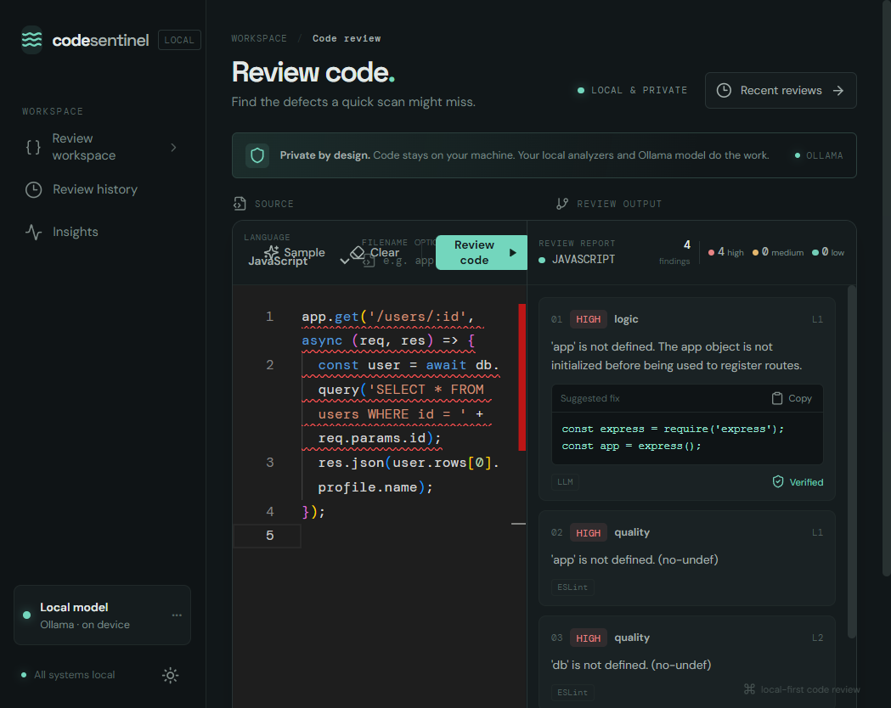
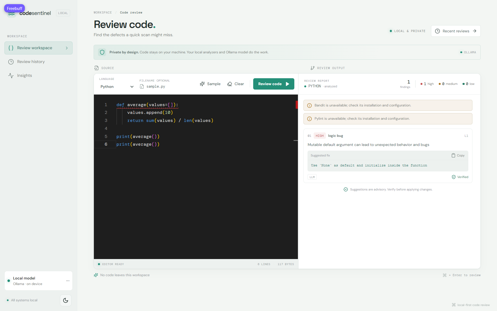
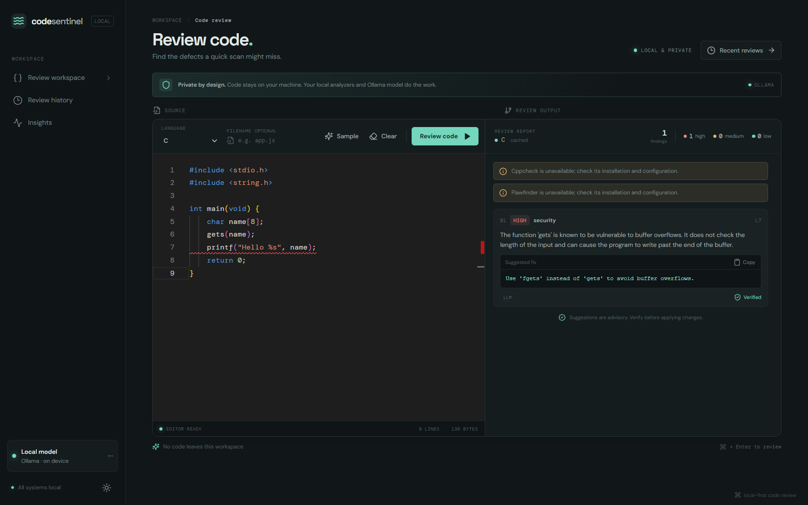

# CodeSentinel — Intelligent Code Review and Bug Detection System using LLMs

Paste code into a modern workspace, pick one of eight languages (or let detection figure it out), and get line-specific findings from local static analyzers **and** a local Ollama model — with explanations, suggested fixes, verification status, history and statistics.

Everything runs on your machine: the editor, the analyzers, the model and the database.

> Code is never executed. Static analysis and model reviews can miss defects and can report false positives. Findings are suggestions, not a guarantee that code is secure or bug-free. Never treat a green review as proof that code is safe.

**Read [architecture.md](architecture.md) for the full end-to-end process and the reasoning behind every technology in the stack.**

---

## Demo

| Dark theme | Light theme |
|---|---|
|  |  |

More captures live in [screenshots/](screenshots) — C, C++, Java, JavaScript and Python reviews, each generated against a real `llama3.1:8b` model run.

---

## Capabilities

- **Eight language categories** — JavaScript, Java, Python, C, C++, HTML, CSS, SQL — with explicit override, filename extension detection, content inspection for ambiguous `.h` files, and heuristic fallback (always labelled as a guess).
- **Real static analysis** — ESLint (bundled as a workspace dependency, so JavaScript works with no global install), plus optional Pylint, Bandit, PMD, Cppcheck, Flawfinder, HTMLHint, Stylelint and SQLFluff. Missing tools become visible warnings, never silent passes.
- **Local LLM review** — Ollama with strict JSON responses, language-specific prompt checklists, bounded concurrency, confidence filtering, and an optional second pass that confirms or drops every candidate.
- **Reliable line mapping** — tree-sitter-powered chunking keeps original line numbers, so every finding points at the exact source line in the editor.
- **Merger and ranking** — static and model findings are deduped, merged when they overlap, ranked by severity then line, and labelled with their sources (`ESLint`, `LLM`, or both).
- **Persistence and caching** — MongoDB stores every review behind a content-hash cache key; history is paginated, statistics are aggregated.
- **Statistics** — issues by category, severity risk, 30-day activity and language mix, drawn with Recharts.
- **Offline-first** — Monaco is bundled locally instead of loaded from a CDN.



---

## Project structure

```text
CodeSentinel/
├── client/                     # React 19 + Vite frontend
│   ├── src/
│   │   ├── components/
│   │   │   ├── layout/         # AppLayout (sidebar shell)
│   │   │   ├── editor/         # CodeEditor, EditorToolbar, LanguageSelector
│   │   │   ├── review/         # ResultsPanel, IssueCard, SummaryBar, SeverityBadge, AnalyzerWarnings
│   │   │   └── common/         # Empty / Loading / Error states
│   │   ├── routes/             # ReviewPage, HistoryPage, StatsPage
│   │   ├── hooks/              # useReview, useTheme
│   │   ├── services/api.js     # every fetch in one place
│   │   ├── utils/              # monaco.js (local Monaco loader), samples.js
│   │   └── styles/             # tokens.css → global → layout → page styles
│   ├── index.html
│   └── vite.config.js
├── server/                     # Express API
│   ├── src/
│   │   ├── routes/             # health, review, reviews, stats
│   │   ├── controllers/        # reviewController, historyController, statsController
│   │   ├── services/
│   │   │   ├── languageDetector.js
│   │   │   ├── chunker.js      # tree-sitter → lexical → structural → whole file
│   │   │   ├── analyzers/      # tool registry, baseAnalyzer, bundled eslint.config.mjs
│   │   │   ├── llmReviewer.js  # Ollama calls + two-pass verification
│   │   │   ├── merger.js       # dedupe, merge, rank
│   │   │   └── reviewPipeline.js
│   │   ├── prompts/            # one checklist .md per language
│   │   ├── models/Review.js
│   │   ├── schemas/            # Zod: review request, pagination, findings, report
│   │   ├── config/             # env.js (Zod-validated), database.js
│   │   ├── middleware/         # errorHandler, notFound
│   │   └── utils/              # processRunner, hash, languageConfig, asyncHandler
│   ├── tests/                  # unit/ + integration/ + fixtures/
│   └── .env.example
├── scripts/
│   ├── doctor.js               # probes Ollama, MongoDB and every analyzer
│   └── setup.ps1
├── screenshots/                # captured UI and review captures
├── package.json                # npm workspaces root
├── .env.example
└── README.md
```

---

## Requirements (Windows 10/11)

- Node.js 20+ and npm
- MongoDB Community Server locally, or a MongoDB Atlas URI
- Ollama installed locally (mock mode exists only for tests/explicit development)
- Optional analyzer executables on `PATH` or configured in `server/.env`
- **No Docker required**

---

## Setup in PowerShell

From the project root:

```powershell
npm install
Copy-Item server/.env.example server/.env
notepad server/.env
```

Defaults: `mongodb://127.0.0.1:27017/intelligent-code-review` and `http://127.0.0.1:11434`.

**Start MongoDB** (if installed as a service):

```powershell
Start-Service MongoDB
```

**Install Ollama** from [ollama.com/download](https://ollama.com/download), then pull the configured model:

```powershell
ollama pull qwen2.5-coder:7b
ollama list
```

**Check your machine, then run both apps:**

```powershell
npm run doctor
npm run dev
```

Open **http://localhost:5173**. API health: **http://localhost:5000/health**.

Individual processes: `npm run dev:server` · `npm run dev:client` · `npm start` (built server).

A guided bootstrap (`npm install` + `.env` copy) is available via `./scripts/setup.ps1`.

---

## Scripts

| Command | What it does |
|---|---|
| `npm run dev` | Server (`:5000`) and client (`:5173`) together via `concurrently` |
| `npm run dev:server` | Express with nodemon |
| `npm run dev:client` | Vite dev server |
| `npm start` | Production server (`node src/server.js`) |
| `npm run build` | Client bundle → `client/dist` |
| `npm test` | Server test suite (Vitest) |
| `npm run test:watch` | Tests in watch mode |
| `npm run doctor` | Probe Ollama, MongoDB and all analyzers |

---

## Environment

Copy `server/.env.example` → `server/.env`:

| Variable | Default | Meaning |
|---|---|---|
| `PORT` | `5000` | Express port |
| `MONGODB_URI` | local `intelligent-code-review` | MongoDB connection |
| `FRONTEND_ORIGIN` | `http://127.0.0.1:5173` | Allowed browser origin (must match Vite) |
| `OLLAMA_BASE_URL` | `http://127.0.0.1:11434` | Ollama origin |
| `OLLAMA_MODEL` | `qwen2.5-coder:7b` | Locally installed model |
| `OLLAMA_TIMEOUT_MS` | `120000` | Per-call timeout |
| `MOCK_LLM` | `false` | Deterministic responses; enable only deliberately |
| `VERIFY` | `true` | Second pass confirming/dropping every candidate |
| `MIN_CONFIDENCE` | `0.65` | Minimum model confidence kept |
| `LLM_CONCURRENCY` | `3` | Max parallel model calls |
| `MAX_SOURCE_BYTES` | `204800` | Pipeline source cap |
| `MAX_CHUNK_CHARS` | `12000` | Preferred chunk size |
| `*_PATH` | tool command name | Executable override for an optional analyzer |

Malformed values and invalid URLs **fail startup** with the offending field named. Analyzer paths are optional and default to command names discovered on `PATH`.

---

## Analyzers and doctor

`npm run doctor` probes the Ollama server **and** the configured model, the MongoDB connection, and every configured analyzer executable, printing a version or an install hint. It exits successfully when optional tools are missing, because reviews still run with those tools skipped.

Executable resolution order: explicit absolute path in `server/.env` → machine `PATH` → workspace `node_modules/.bin`. Windows `.cmd` shims from npm and pip are launched through `cmd.exe` with quoted arguments, so `ESLINT_PATH=eslint` works for a global *or* workspace install.

| Language | Optional analyzers |
|---|---|
| JavaScript | ESLint *(bundled)* |
| Python | Pylint, Bandit |
| Java | PMD |
| C / C++ | Cppcheck, Flawfinder |
| HTML | HTMLHint |
| CSS | Stylelint |
| SQL | SQLFluff |

Typical installs: `npm install -g htmlhint stylelint`, `pip install pylint bandit flawfinder sqlfluff`, [PMD](https://pmd.github.io/), `winget install Cppcheck.Cppcheck`. Re-run the doctor afterwards.

Each adapter parses the tool's real output and validates normalized findings. Absence, timeouts and malformed output become warnings — the app never invents analyzer findings. The JavaScript analyzer always uses CodeSentinel's own flat config, so pasted snippets never pick up an unrelated project's ESLint setup.

---

## Review workflow and line mapping

1. **Detect** — explicit language wins, then extension; ambiguous `.h` inspects contents; otherwise conservative content heuristics produce a labelled guess. Aliases: `.js/.jsx/.mjs/.cjs`, `.java`, `.py`, `.c`, `.h`, `.cpp/.cc/.cxx/.hpp/.hh/.hxx`, `.html/.htm`, `.css`, `.sql`.
2. **Chunk** — tree-sitter grammars (WASM, no native build) find functions/classes for JS/Python/Java/C/C++; lexical scanning, structural separators (HTML/CSS/SQL) and whole-file fallback keep working when parsing fails. Original line offsets and imports are retained on every chunk.
3. **Analyze** — each configured tool runs against a temp file; output is parsed and validated.
4. **Review** — the model returns strict JSON per chunk, lines clamped into the chunk's real range, concurrency bounded by `LLM_CONCURRENCY`.
5. **Verify** (when `VERIFY=true`) — one extra call per chunk verdicts every candidate; rejected findings are dropped, and a failed verification surfaces as an error rather than a fake "verified".
6. **Merge** — low-confidence findings are filtered, adjacent same-category findings merge keeping both sources, and results sort high → medium → low then by line.
7. **Persist** — the report is saved under a cache key covering source, language, model and review settings.

---

## Using the workspace

1. Paste code or press **Sample** for a deliberately buggy example in the selected language.
2. Choose a language or keep **Auto-detect**; a filename improves detection.
3. Press **Review code** or `Ctrl+Enter` (`Cmd+Enter` on macOS). Cancel is available while the model runs.
4. Click a finding to jump to its source line; **Copy** grabs the suggested fix.
5. Revisit results under **Review history**, and patterns under **Insights**.

Theme preference persists in `localStorage`. Source and reports are stored in the configured MongoDB because persistence and caching are part of this app's workflow.

---

## API

| Endpoint | Description |
|---|---|
| `GET /health` | Server, database and non-secret model readiness |
| `POST /api/review` | `{ code, language?, filename? }` — body max 200 KB |
| `GET /api/reviews?page=1&limit=10` | Paginated history (max 50/page) |
| `GET /api/reviews/:id` | Saved source and report |
| `GET /api/stats` | Category, severity, language and daily activity counts |

```powershell
$body = @{ code = 'function greet(user) { return user.profile.name; }'; language = 'javascript' } | ConvertTo-Json
Invoke-RestMethod -Uri http://localhost:5000/api/review -Method Post -ContentType 'application/json' -Body $body
```

The review endpoint is limited to **20 requests/minute/IP**. Errors are `{ "error": { "message": "...", "code": "..." } }`. Review persistence requires MongoDB; database failures are never reported as successful saves.

---

## Tests

```powershell
npm test
```

45 tests across 8 files: language detection, chunking for all eight languages, merge/dedupe behaviour, confidence and stable hashing, mock-mode LLM behaviour, `cmd.exe` quoting, real ESLint analyzer output, and full API integration against `mongodb-memory-server`.

Ordinary runs need no Ollama. Analyzer tests that require an absent executable skip explicitly instead of faking a pass. The memory server may download a MongoDB binary on first run.

---

## Troubleshooting (Windows)

- **Mongo unavailable** — `Get-Service MongoDB`, verify port/URI, or use an Atlas URI. The API does not start without a connection.
- **Ollama unavailable / model missing** — `ollama list`, then `ollama pull qwen2.5-coder:7b`; check `OLLAMA_BASE_URL`.
- **Analyzer missing** — `npm run doctor`, install the tool, or set its `*_PATH`.
- **Port clash** — change `PORT` in `server/.env` or Vite's port in `client/vite.config.js`, and update `FRONTEND_ORIGIN`.
- **Atlas URI fails to parse** — URL-encode special characters and allow your client IP.
- **Memory-server download fails** — allow the first test run to fetch its binary.

---

## Security and limitations

- Code is size-limited, validated, written to a random temp directory, passed to analyzers as argument arrays (never shell interpolation) and removed in `finally`.
- CORS is restricted to the configured origin; the review route is rate-limited; API errors expose no stack traces or secrets.
- Installed analyzers are trusted local programs — a malicious one is a local trust risk.
- **No auth or multi-user isolation.** Do not expose this local service publicly without adding authentication, origin/CSRF protections, quotas and monitoring.
- Ollama prompts contain the source you submit; keep the endpoint under your control.
- Static analysis and LLMs can both miss bugs or misclassify code.

**Future ideas:** per-language analyzer fixture tests, sandboxed analyzer plugins, richer tree-sitter incremental chunking, exportable review reports.
